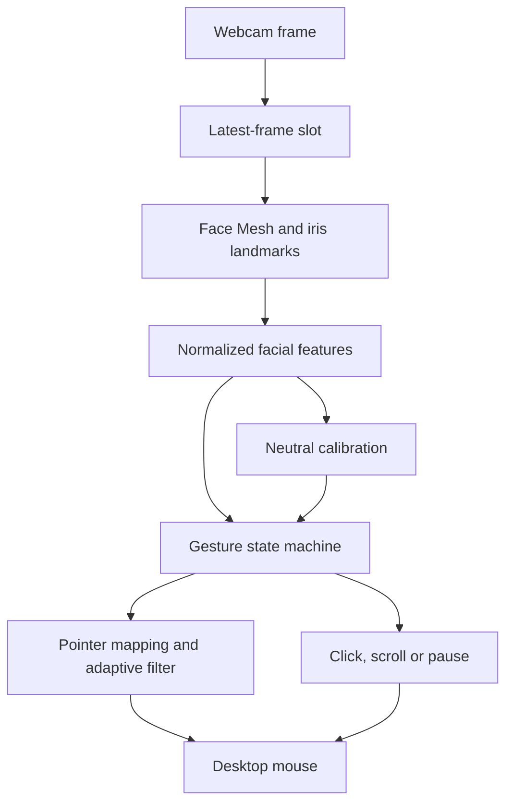

# Report notes and defensible novelty

## Proposed title

**Eye-Controlled Mouse with Calibrated Gestures and Low-Latency Cursor Control**

Keep the existing project's problem statement and OpenCV/MediaPipe/PyAutoGUI pipeline. Describe the contribution as an extension of the baseline, with an explicit distinction between established methods and your implementation/evaluation work.

## Suggested contribution paragraph

We extend our face-mesh mouse controller with a calibrated, gesture-aware control stage. The stage normalizes eyelid opening by eye width and by a neutral calibration, separates unilateral winks from bilateral blinks, and holds the cursor during gestures that would otherwise disturb its position. A speed-adaptive filter stabilizes pointer motion, while latest-frame processing and removal of unnecessary mouse-library pauses reduce avoidable delay. Our contribution is the integration and evaluation of these components in the existing controller. The landmark detector, eye aspect ratio and One Euro filter are established methods and are credited to their original sources.

This is a **candidate course-project contribution**, not evidence of a globally new algorithm. The strongest defense is a controlled comparison showing fewer unwanted clicks and a better jitter/latency trade-off on your task. The professor decides whether that contribution meets the course novelty requirement.

## Proposed method, aligned with the actual code

1. Capture the newest webcam frame. Resize only when needed, mirror it and convert BGR to RGB.
2. Run the same pretrained MediaPipe Face Mesh with refined iris landmarks and one face.
3. Compute two eye aspect ratios from pixel-space distances, mouth opening divided by mouth width, and head roll from eye-corner midpoints.
4. Estimate neutral iris position, open-eye ratios and roll using medians over 45 valid frames.
5. Gate mouse actions with a temporal state machine. A bilateral closure cancels a pending wink; a unilateral wink must last 0.15–1.0 seconds and produces one click on release. The pointer holds during this interval. Mouth opening held 0.6 seconds toggles control.
6. When both eyes are open and no other gesture is active, map iris-center displacement from neutral to the screen and apply the One Euro filter.
7. Dispatch mouse actions with zero configured post-call pause and record stage timings.

For each eye, with corner points p1, p4 and paired upper/lower eyelid points p2/p6 and p3/p5:

`EAR = (||p2-p6|| + ||p3-p5||) / (2 ||p1-p4||)`.

The closure threshold is 0.55 times that eye's calibrated EAR; reopening uses 0.75 times calibrated EAR. This hysteresis prevents repeated state flips near one threshold. Distances use x×image_width and y×image_height, so the ratio respects frame aspect ratio.

Cursor mapping before filtering is:

`x_screen = [0.5 + gain_x × (iris_x - neutral_x)] × (screen_width - 1)`

`y_screen = [0.5 + gain_y × (iris_y - neutral_y)] × (screen_height - 1)`.

This retains the original image-position control idea. It is **not a learned or geometric screen-gaze estimator**, and head movement contributes to pointer movement. Do not describe it as looking directly at a target and accurately locating that gaze point.

For the overview figure, use this structure:

## Corrections needed in the existing PDF

- The existing mouth-toggle description now matches the code, but specify a sustained opening and reopening, not an immediate toggle on every frame.
- Replace the old appendix with the final code modules, including the entry point. Link to the repository revision submitted.
- The old 107.52/110.22/217.37/105.01/107.65 ms table measures time around mouse API calls, excluding capture and model inference. It must not be presented as end-to-end system latency.
- Keep old numbers only as clearly labeled **previously reported API-call measurements**. Do not compare them numerically with the new headless server timings as though the hardware and measurement scope were identical.
- Replace statements of robust or accurate performance with evidence from recorded trials. The original success counter does not measure accuracy: it marks every triggered event successful and cannot count missed intentions or unwanted actions.
- Include an explicit related-work comparison, all code/data links, and each group member's actual contribution. Do not invent names, responsibilities or experiments.

## Experiments to finish locally

Use a fixed setup and repeat each condition in alternating order. Record Python/library versions, CPU, webcam model, requested/actual resolution and lighting. Use the same participants and task for both versions. Short voluntary trials under ordinary room light and dimmer light are sufficient for a course comparison if the sample size and limitations are clearly reported.

| Experiment | Baseline/control | Revised condition | Measure |
|---|---|---|---|
| Avoidable API delay | Revised code with `--mouse-pause 0.1` | Revised code with `--mouse-pause 0` | Median/p95 of `native_action_timings_ms`; same task |
| Queue policy | `--serial-camera` | Default latest-frame capture | Read-complete-to-dispatch age, processed FPS, skipped frames |
| Filtering | `--no-smoothing` | Default filter | Stationary pointer jitter and target acquisition time |
| Gesture conflicts | Original script | Revised controller | False clicks during ordinary blinks; correct/incorrect/missed deliberate winks |
| Practical demo | Original script | Revised controller | Target hit rate and time to acquire the same-sized targets |

Suggested manual gesture trials: 20 deliberate left winks, 20 right winks, 30 ordinary bilateral blinks, 10 scroll attempts in each direction and 10 mouth toggles. Record intended action and emitted action independently, including missed and unintended actions. Report counts and sample size. Precision and recall require these labels; event logs alone are not ground truth.

Keep these timing concepts separate:

- **Inference time:** just `FaceMesh.process`.
- **Read-to-dispatch:** after `VideoCapture.read()` returns through mouse dispatch completion; includes waiting in the application's latest-frame slot, but excludes camera exposure/driver buffering and display response.
- **Gesture recognition delay:** includes deliberate holds and release confirmation. Removing a 100 ms API pause does not remove a 150 ms wink requirement or 600 ms mouth hold.
- **Target acquisition time:** human task duration, not algorithm latency.
- **True end-to-end latency:** needs an external observation method (for example, high-frame-rate video showing the movement and screen response).

## Existing components and sources

- Original project and historical write-up: https://github.com/aksht17/iMouse/tree/c26cb16
- MediaPipe Face Mesh: https://github.com/google-ai-edge/mediapipe/blob/master/docs/solutions/face_mesh.md
- MediaPipe Iris limitations: https://github.com/google-ai-edge/mediapipe/blob/master/docs/solutions/iris.md
- Soukupova and Cech, *Real-Time Eye Blink Detection using Facial Landmarks*, CVWW 2016: https://cmp.felk.cvut.cz/ftp/articles/cech/Soukupova-CVWW-2016.pdf
- Casiez, Roussel and Vogel, *1 Euro Filter: A Simple Speed-based Low-pass Filter for Noisy Input in Interactive Systems*, CHI 2012: https://gery.casiez.net/1euro/
- PyAutoGUI pause and fail-safe behavior: https://pyautogui.readthedocs.io/en/latest/index.html#fail-safes
- OpenCV video capture API: https://docs.opencv.org/4.x/d8/dfe/classcv_1_1VideoCapture.html
- NASA astronaut image used only for the automated smoke test, distributed by scikit-image: https://github.com/scikit-image/scikit-image/blob/v0.24.0/skimage/data/astronaut.png

No model was trained or fine-tuned in this revision. There is no new training dataset. The repeated-image fixture and synthetic features are software checks, not a representative evaluation dataset.
